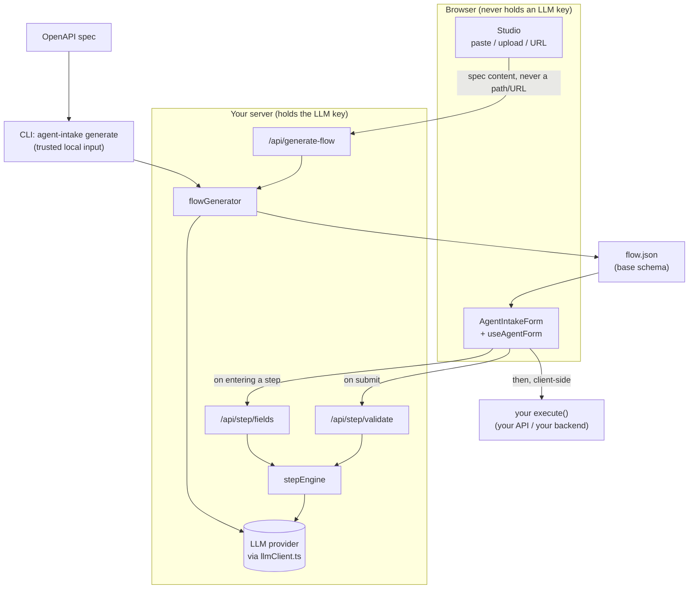
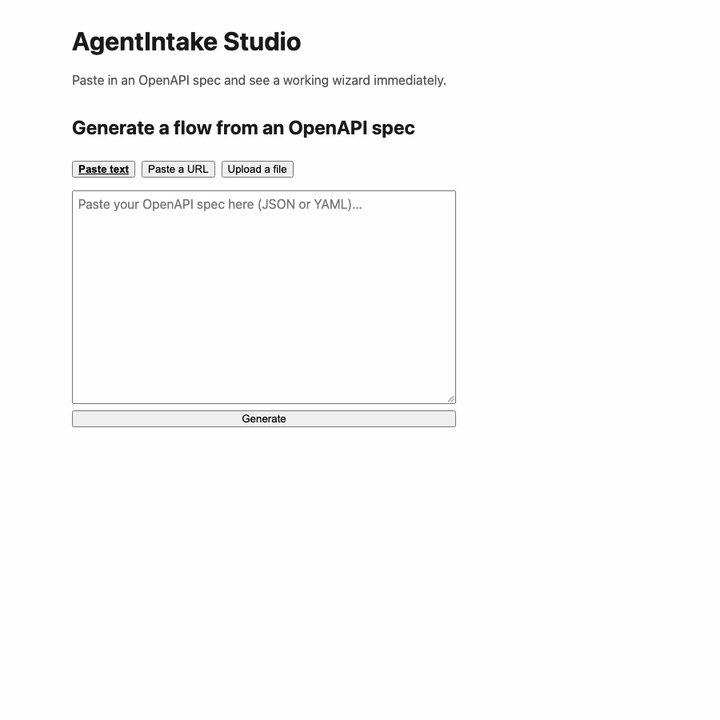
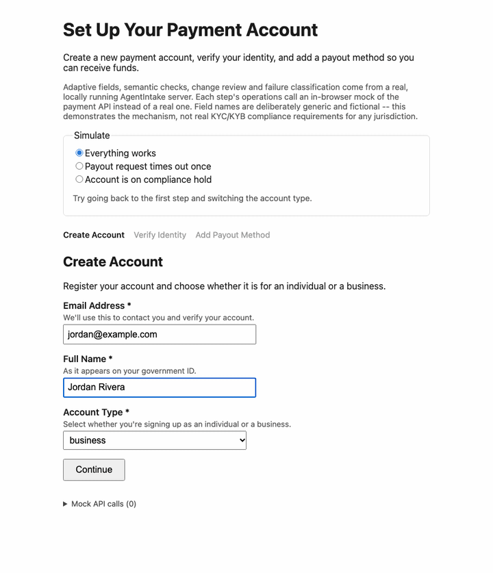
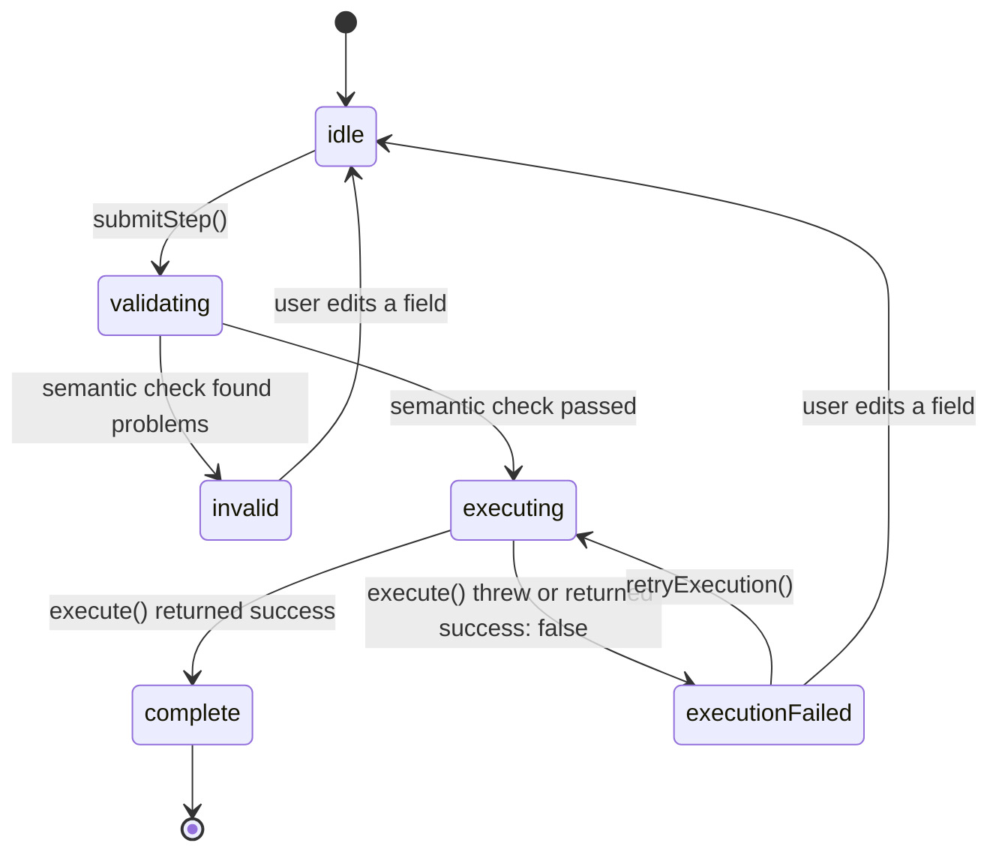

# AgentIntake

**Turn an OpenAPI spec into a single, AI-orchestrated, multi-step form wizard.**

AgentIntake reads your OpenAPI spec to build a base schema (which endpoints, which fields, what's required), then adapts that wizard at runtime: which fields are relevant to show on each step given what the user has already answered, and whether a submitted value is actually plausible. The person filling it out always sees and edits **real form controls, one step per endpoint** — never a chat window.



The CLI and Studio share the same `flowGenerator`; Studio reaches it through `/api/generate-flow`, the CLI calls it directly. Every LLM call happens on the server — **the provider API key never reaches the browser**.

## Why a wizard and not a chat

Multi-endpoint intake (onboarding, KYC-style verification, provisioning) is a form problem: people want to see what's being asked, correct earlier answers, and know how far along they are. A chat transcript hides all of that. So the interaction surface is a wizard, and the AI is an active participant in exactly two bounded ways:

1. **Adaptive field selection, per step.** Before a step renders, the backend asks the model which of that step's base fields are relevant given everything collected so far, in what order, and whether any can be pre-filled with a confident suggestion (shown as AI-suggested and editable).
2. **Semantic validation, per step.** On submit, the model checks values for things regex and range checks can't catch — implausible values, and inconsistencies with earlier steps.

### The "no invented fields" bound

The model can only **show, hide, reorder, annotate, or pre-fill fields that already exist in the base schema**. It can never introduce a field. This is enforced structurally, not by prompt: the LLM's output schema is built per call from the real field names (a Zod enum), so a response naming any other field fails validation and is discarded. The same principle protects generation: `flowGenerator` lets the model supply only a field's `name` and optional label/description overrides — `type`, `required`, `enumValues` and `validation` are always rehydrated from the parsed spec by name, never trusted from the model. (An earlier prompt-only version of this guardrail let a real generation run silently corrupt a field's regex pattern; that is why it's structural now.) Both guardrails have dedicated tests.

## Quickstart

AgentIntake is not published to npm yet; run it from a clone. Requires Node.js 20.19+ or 22.12+ (running the test suite needs 22.12+).

```bash
git clone https://github.com/fdamianenriquez/AgentIntake.git
cd AgentIntake
npm install
npm run build
cp server/.env.example .env   # then add an API key (see "Choosing an LLM provider")
```

`npm run build` compiles the CLI to `dist/`. The commands below use `node dist/cli/index.js`; run `npm link` once if you'd rather type `agent-intake`.

### Path 1 — CLI (developers, scriptable, CI-friendly)

```bash
node dist/cli/index.js generate \
  --spec server/specs/example-payment-onboarding.openapi.yaml \
  --output flow.json
```

`--spec` accepts a local path or URL — the CLI's caller is a trusted local developer, so it fully resolves `$ref`s, including external ones. `--provider` and `--model` override the environment for one run; if you switch providers with `--provider`, `LLM_API_KEY` must hold that provider's key. Generation flags any fields whose purpose it found ambiguous so you can review them.

The output is a `FlowDef` **without** `execute` functions. Review it, then add each endpoint's `execute` by hand — AgentIntake never generates that part (see [Authentication model](#authentication-model)).

If the output file already exists and has [author guidance](#author-guidance) in it, `generate` refuses to overwrite it, before calling the model: pass `--keep-guidance` to carry the flow's guidance and each step's guidance over to the new flow by endpoint id (it lists the steps whose guidance was dropped because they are no longer in the spec, and checks the kept guidance against the limits first), or `--force` to overwrite it. A flow without guidance is overwritten as before. Generation also uses the global guidance in `agentintake.config.json` (for example its output language, for the labels and descriptions it writes).

### How the spec becomes steps

Each write operation becomes one step, with two refinements:

- **Resource families.** `POST /accounts` together with the operations on `/accounts/{accountId}` is one step, not several. `GET`, `PUT`/`PATCH` and `DELETE` on the item path are recorded on that step as `capabilities` (read, update, undo), along with `resourcePath` and `idParam`. The item path must be exactly the collection path plus one `{parameter}` segment; nested collections such as `POST /accounts/{accountId}/payout-methods` work the same way. A `PUT`/`PATCH` that doesn't belong to such a family (a singleton like `/me/settings`, or an item path with no `POST` on its collection) stays a step of its own, with a warning.
- **Parameters.** Only query parameters and request-body properties become form fields. Path parameters (like `accountId` above) are listed in `pathParams` -- they are ids you fill in your operations from `ctx.results`, not something to ask the user. Header and cookie parameters are never fields; a required header that isn't the auth credential produces a warning so you remember to send it.

The CLI prints these warnings and, after writing `flow.json`, a short list of what each endpoint needs (offered read/update/undo operations, path parameters to fill). Studio shows the same warnings above the preview. If you generated a `flow.json` with an earlier version, regenerate it: item-path updates used to be separate steps, and path and header parameters used to be form fields.

### Path 2 — Studio (no code required)

```bash
node dist/cli/index.js studio          # http://127.0.0.1:4000, opens your browser
node dist/cli/index.js studio --port 4100 --no-open
```

Paste raw spec text, upload a file, or paste a URL. Studio validates that the input looks like OpenAPI before doing anything and shows plain-language errors. Click **Generate** to get a live wizard rendered with the real `<AgentIntakeForm />`, then download `flow.json` or copy the embed snippet.



*Captured from a real run against the example spec; frames are spaced out, not real time.*

The preview runs in **Preview mode**: adaptive fields and semantic validation are real LLM calls, but each step's `execute()` is simulated — it logs what it *would* call to the browser console instead of hitting any API. A notice in the UI says so.

Next to the preview, the **Instructions** tab edits [author guidance](#author-guidance) without touching a file by hand:

- **Global guidance** — one control per slot, with a character counter and its limit. **Save** writes `agentintake.config.json` (the path is shown) and Studio uses it at once, without a restart; validation errors appear next to the field.
- **Flow and step guidance** — flow guidance, the flow's output language, and one field per step. They live in the flow: the preview uses them immediately, and the downloaded `flow.json` includes them.
- **What the model receives** — the prompt for a chosen call and step, built by the same code the server uses, with your guidance block highlighted and everything else shown as fixed text. There is no free-text prompt editor.
- **Test** — runs the [built-in eval cases](#checking-guidance-with-eval-prompts) for the calls whose guidance changed (or the ones you pick) against your configured model, after showing how many runs it will make and with which model, then shows a table per call and the failing runs. The built-in cases use an example payment-onboarding flow, so your global and flow guidance applies to them, but step guidance only reaches a case through a step with the same id; Studio says so, and warns when none of your guided steps match. Use `eval-prompts --cases` for cases built on your own flow.

Regenerating a flow in the same Studio session keeps its flow and step guidance by endpoint id and lists any steps whose guidance was dropped.

Studio itself resolves a pasted URL or uploaded file to spec *content* in your browser first. Fetching a URL from the browser is subject to that host's CORS policy, so some URLs will fail there; pasting the spec text always works.

### Choosing an LLM provider

One `.env` at the project root is the source of truth. It is read from the directory you run the command in.

| Variable | Meaning |
|---|---|
| `LLM_PROVIDER` | `anthropic` (default), `openai`, `google`, or `openrouter` |
| `LLM_MODEL` | Provider-specific model name; optional, each provider has a default |
| `LLM_API_KEY` | Your API key for the provider named in `LLM_PROVIDER` — one variable for all of them, so it must be a key for that provider |
| `AGENTINTAKE_STATIC_MODE` | Any value other than empty, `false` or `0` turns adaptivity off (see below) |
| `PORT` | Port for the runtime server (`npm start`), default `3000` |
| `AGENTINTAKE_CORS_ORIGINS` | Comma-separated origins allowed to call the runtime server from a browser (e.g. `https://app.example.com`). Unset, every origin is allowed and the server logs a warning at startup — see [Deploying the runtime server](#deploying-the-runtime-server) |
| `AGENTINTAKE_CONFIG` | Path of the [author guidance](#author-guidance) config file, instead of `agentintake.config.json` in the working directory. A missing file at this path is an error |
| `AGENTINTAKE_FLOWS_DIR` | Directory of `flow.json` files the runtime server trusts for guidance — see [Trust model](#trust-model-and-trusted-flows) |
| `AGENTINTAKE_LOG_LEVEL` | `error`, `warn` (default), `info` or `debug` — see [Logging](#logging). Any other value stops startup |

Defaults: `anthropic` → `claude-haiku-5-5`, `openai` → `gpt-6-luna`, `google` → `gemini-3.8-flash`, `openrouter` → `openrouter/free`. Each is a fast, low-cost tier that did well in the comparison below; set `LLM_MODEL` to use a larger model. `openrouter` is an extra fourth option (OpenAI-compatible API, reached through the same SDK); `openrouter/free` is OpenRouter's own router across whichever free models are currently available, so it costs nothing to try but can hand consecutive requests to different underlying models.

How each way of running it finds its provider:

- **CLI `generate`** — reads `.env` if present. Variables already set in your shell (for example CI secrets) take precedence over `.env`, and `--provider` / `--model` take precedence over both. It fails fast, before touching the spec, with a specific message if `LLM_API_KEY` is missing or `LLM_PROVIDER` isn't a supported value — never a raw SDK error. Because one variable serves every provider, a key that belongs to a *different* provider can't be detected up front; the provider rejects it on the first call.
- **Studio** — if no valid provider and key are configured, it shows a one-time setup screen in the browser: pick a provider, paste the key. It is written to `.env` in the directory you launched Studio from, so no text-file editing is needed and you aren't asked again next session.
- **Runtime wizard server** (`npm start`) — reads `.env` like the CLI. This is a deployment-time concern of whoever hosts the wizard; the person filling out the form never sees or configures it.

**Honest caveats.** Structured-output reliability varies by provider and by model. Every provider goes through the same Vercel AI SDK `generateObject` interface, and every LLM output schema is kept to the subset all of them accept (no `oneOf`, no optional properties, no open-ended maps — a test checks this), but the models themselves differ. The [built-in eval suite](#checking-guidance-with-eval-prompts) — 33 cases with a known correct answer across the five LLM calls, run twice each (66 runs), through OpenRouter — gave:

| Model | Passed | Fell back | generation p50 / p95 | step calls p50 / p95 |
|---|---|---|---|---|
| `anthropic/claude-haiku-5.5` | 66/66 (100%) | 0 | 6.4 s / 7.8 s | 2.2–2.6 s / 2.9–3.8 s |
| `openrouter/free` | 40/66 (61%) | 26 | 27.6 s / 90.8 s | 6.7–10.3 s / 15.0–30.0 s |

Per call for `openrouter/free`: generation 7/8, adaptive fields 6/14, semantic validation 5/16, later-step review 11/14, failure classification 11/14 — and every one of its failures was a fallback (mostly timeouts), not a wrong answer. A small sample, not a benchmark suite, but the gap is clear: the free router is fine for trying the tool out, and much of the time the wizard runs on its fallback path with it. A call that runs past its timeout degrades gracefully (below) rather than blocking. Run `eval-prompts` yourself to measure the model you configure. Live calls against real providers are deliberately not part of the automated tests (they'd need funded keys for every provider on each CI run); provider wiring, schema compatibility and the fail-fast errors are.

### Running the demo

The demo is a "Payment Account Onboarding" wizard built from `server/specs/example-payment-onboarding.openapi.yaml`: three resource families, two of them nested under the account.

| Step | Created with | Revisit / undo with |
|---|---|---|
| Account | `POST /accounts` | `GET`, `PATCH`, `DELETE /accounts/{accountId}` |
| Verification | `POST /accounts/{accountId}/verifications` | `GET`, `PATCH`, `DELETE …/verifications/{verificationId}` |
| Payout method | `POST /accounts/{accountId}/payout-methods` | `DELETE …/payout-methods/{payoutMethodId}` (no read or update) |

```bash
npm start                                   # AgentIntake server on :3000
npx vite --config demo/vite.config.ts       # demo UI on :5173
```



*Captured from real runs; frames are spaced out, not real time. Field descriptions are written by the model at runtime.*

The demo's operations call an in-browser mock of that API (`demo/mockApi.ts`), so nothing needs to run besides the two commands above; a log under the form lists every mock call. A "Simulate" switch picks what the mock does:

- **Adaptive fields:** every verification field is optional in the spec (OpenAPI can't express "required only if an earlier answer was X"), and the step engine narrows them at runtime: `individual` shows the three individual fields, `business` the five business ones.
- **Cross-step validation:** the payout step's account holder name is checked against the name collected earlier, which no regex could do.
- **A — payout request times out once:** the first attempt does create the payout method, but the response never arrives. The timeout is classified as retryable without an LLM call; Retry sends the same idempotency key, so the mock returns the payout method it already created instead of a second one (the log shows the timed-out POST, then a 201 with the same id).
- **B — account on compliance hold:** adding a payout method fails with a 403; the model classifies it as fundamental and the form proposes undoing the verification and the account. After you confirm, the mock receives the two `DELETE`s in reverse order and the form starts again at the first step.
- **C — change an earlier answer:** complete the flow, go back to the account, and switch `individual` → `business`. The account is updated with `PATCH`; the model flags the later steps, and verification, whose questions changed, has to be updated with the business fields before the flow is complete again. The payout method, which can't be changed here, can only be kept.

- **With author guidance:** a "Flow" switch picks the same flow with [author guidance](#author-guidance) (`demo/flow.guided.json`): flow guidance, guidance on the account and payout steps, and `outputLanguage: "es-MX"`. The model's field descriptions, validation messages and review reasons come out in Spanish, and the payout step's guidance (the account holder name in capital letters) is enforced by semantic validation. The form's own buttons and messages, and the labels already in `flow.json`, stay in English — see [Languages](#languages).

Live runs depend on the configured model: with a slow or unreliable one, a call may time out and the form falls back as described above (full field list, everything marked for review, no undo proposed). Field names are deliberately generic and fictional; the demo illustrates the mechanism and is **not** guidance on the KYC/KYB requirements of any jurisdiction.

## Authentication model

AgentIntake **surfaces** what authentication each endpoint declares (`EndpointDef.auth`, extracted from the spec's `securitySchemes`). It does **not** manage, store or refresh credentials, and it isn't an auth library. Two patterns:

1. **Backend-proxied `execute()` (recommended).** `execute()` calls your backend, and your backend holds the credential and forwards the request. The secret stays server-side, and it sidesteps CORS — most third-party and internal APIs won't allow your wizard's origin.
2. **Direct from the browser, user-scoped token only.** For APIs explicitly designed for it. Pass `getAuthHeaders: () => Record<string, string>` to the hook or component; it's handed to `execute()` in its `context` argument.

No OAuth login flow, token refresh or credential storage is provided.

## React API

The package lives in `packages/react-agent-intake` (published name: `react-agent-intake`).

```tsx
import { AgentIntakeForm } from 'react-agent-intake';

<AgentIntakeForm flow={flow} apiUrl="http://localhost:3000" getAuthHeaders={optional} />
```

`AgentIntakeForm` is a thin, replaceable consumer of the hook. It maps `FieldDef.type` (`string`, `number`, `boolean`, `date`, `enum`) to generic controls with no per-field JSX, shows a stepper, and marks completed steps.

```ts
function useAgentForm(
  flow: FlowDef,
  options: {
    apiUrl: string;
    getAuthHeaders?: () => Record<string, string> | Promise<Record<string, string>>;
  }
): {
  currentStepIndex: number;
  totalSteps: number;
  currentStepFields: FieldDef[];
  suggestedValues: Record<string, unknown>;
  values: Record<string, unknown>;
  errors: Record<string, string>;      // set only when currentStepStatus === 'invalid'
  currentStepStatus: StepStatus;
  executionError: string | null;       // set only when currentStepStatus === 'executionFailed'
  loading: boolean;                    // fetching this step's adapted fields
  updateField: (fieldName: string, value: unknown) => void;
  submitStep: () => Promise<void>;
  retryExecution: () => Promise<void>;
  completedEndpoints: string[];        // endpoint ids that reached 'complete'
  isComplete: boolean;
  stepRecords: Record<string, StepRecord>; // per step: last submitted values, result, status
  canGoToStep: (endpointId: string) => boolean;
  goToStep: (endpointId: string) => Promise<void>; // revisit a completed step
  cancelEdit: () => void;
  isEditing: boolean;
  editMode: 'editable' | 'readOnly' | null;
  editPhase: 'idle' | 'validating' | 'saving';
  navigationError: string | null;      // e.g. the step's read() failed
  staleResolution: 'keepOrEdit' | 'mustEdit' | 'followUp' | null; // for the step under review
  acknowledgeStale: () => { ok: true } | { ok: false; reason: 'fieldsChanged' | 'notStale' };
  flagForFollowUp: () => void;
  followUps: { endpointId: string; note: string }[];
  recovery: { phase, classification?, explanation?, proposedUndo?, skipped?, report? }; // see below
  confirmRollback: () => Promise<void>;
  declineRollback: () => void;
  retryRollback: () => Promise<void>;
  error: Error | null;                 // fatal, e.g. a flow with no endpoints
};
```

The hook manages its own `sessionId`, fetches the current step's adapted fields whenever the step changes, and aborts any in-flight request on unmount.

Each endpoint gets either `execute` or `operations` (exactly one):

```ts
interface EndpointDef {
  id: string;
  title: string;
  description?: string;
  fields: FieldDef[];
  auth?: AuthRequirement;
  execute?: (data: Record<string, unknown>, context: ExecContext) => Promise<OperationResult>;
  operations?: {
    create: /* same signature as execute */;
    read?: (ctx: ExecContext & { resourceId: string }) => Promise<{ found: true; data: Record<string, unknown> } | { found: false }>;
    update?: (data: Record<string, unknown>, ctx: ExecContext & { resourceId: string }) => Promise<OperationResult>;
    undo?: (ctx: ExecContext & { resourceId: string }) => Promise<OperationResult>;
  };
}

interface ExecContext {
  getAuthHeaders?: () => Record<string, string> | Promise<Record<string, string>>;
  results: Record<string, OperationResult>; // results of completed steps, by endpoint id
  idempotencyKey: string;                   // same across retries, new after the user edits
}

interface OperationResult {
  success: boolean;
  message?: string;
  resourceId?: string;                      // e.g. the id your API created
  output?: Record<string, unknown>;         // anything a later step needs
  failure?: { kind: 'network' | 'timeout' | 'http' | 'other'; status?: number; message?: string };
}
```

`execute` is the original form and is exactly `operations.create`. Later steps often need what an earlier one created; it arrives as `context.results`:

```ts
import { failureFromResponse } from 'react-agent-intake';

operations: {
  create: async (data, { results, idempotencyKey }) => {
    const accountId = results.createAccount.resourceId;
    const res = await fetch(`/api/accounts/${accountId}/payout-methods`, {
      method: 'POST',
      headers: { 'Content-Type': 'application/json', 'Idempotency-Key': idempotencyKey },
      body: JSON.stringify(data),
    });
    if (!res.ok) return { success: false, failure: await failureFromResponse(res) };
    const created = await res.json();
    return { success: true, resourceId: created.id };
  },
}
```

AgentIntake never calls your API and never inspects its responses itself; mapping a response into an `OperationResult` is your job. `failureFromResponse` does that for errors (status plus the first 500 characters of the body). For `undo`, use `undoResultFromResponse`: it counts 2xx, 404 and 410 as success. An undo should treat "already gone" as done, because if its response is lost (the resource was deleted but the client never heard back), a retry would otherwise fail forever. AgentIntake doesn't assume this for you, since only you know what your API's statuses mean. A 404 also comes back when the request URL itself is wrong — a missing parent id, for example — so build an undo only from ids it actually has (`resourceId`, and `ctx.results` for parents) and throw if one is missing, rather than send a request that "succeeds" without deleting anything. A thrown error, or a failed result without a `failure`, is recorded as `kind: 'other'`. Return `resourceId` from `create` whenever your API gives you one: revisiting a step depends on it. Pass `idempotencyKey` along if your API supports idempotency keys, so a retry after a timeout can't create a duplicate.

### Revisiting completed steps

Completed steps are clickable in the stepper (`goToStep`). What happens depends on what you implemented for that step:

| `read` | `update` | Revisiting the step |
|---|---|---|
| yes | yes | Shows the resource as your API returns it now; changes are saved with `update` |
| no | yes | Shows the values submitted last time; changes are saved with `update` |
| yes | no | Shows the resource read-only |
| no | no | Shows the values submitted last time, read-only |

The step's fields are adapted again to the earlier answers as they are now, and only the visible fields are sent to `update` (the previous values arrive as `ctx.previousValues`, so a PUT-style API can merge). `read` should return values in the form's shape — field names as in the flow, with nested objects fine for dotted names (`{ address: { city } }` fills `address.city`). Each field it returns replaces the local value; a field it leaves out keeps what the user entered, so leave out what your API doesn't return instead of sending a placeholder, and never return masked values (`"***1234"`): the form would show the mask and a later `update` would send it as the real value. Other keys (`id`, `status`, timestamps) are ignored. Saving without changes makes no `update` call. A failed `update` leaves the step as it was — nothing is rolled back. If `read` reports the resource is gone, the step goes back to being filled in and is created again.

When a saved change could affect later steps, the server asks the model which later completed steps really depend on what changed (a name that has to match, fields that only apply to one account type) and only those are marked **needs review** (`stale`), each with a short reason. If that check can't run (static mode, no answer within 30 seconds, provider error), every later completed step is marked, to be safe. The wizard then takes the user through them, never re-creating anything:

- If the step still asks the same questions, it can be **kept as it is** (`acknowledgeStale`) or changed and saved.
- If its questions changed (say, individual → business swaps the verification fields), keeping it is refused and it has to be updated.
- If its questions changed but it has no `update`, it can't be fixed in the wizard: the user accepts it **flagged for follow-up** (`flagForFollowUp`), and the completion screen lists those steps.

The flow counts as complete again once no step needs review. `cancelEdit` discards the change and returns the user to where they were, including anything they had typed on an unfinished step.

### When a step fails

A failed operation is first classified without any LLM call: network errors, timeouts, HTTP 5xx, 408, 429 and 401 are **retryable**, and so is the first failure with no cause given. For other HTTP 4xx responses (or a repeated unexplained failure) the server asks the model to classify it, given what the earlier steps are and what they submitted:

- **retryable** — try again;
- **needs-edit** — the user can fix it by changing this step's answers;
- **fundamental** — the flow can't succeed as set up (an account on hold, say). The model may then name the earliest completed step whose result should be undone, and the form **proposes** undoing that step and everything completed after it, in reverse order, through each step's `undo` operation.

Nothing is undone unless the user confirms (`confirmRollback`); `declineRollback` keeps everything. The undo stops at the first failure and `retryRollback` continues from there. Steps without a usable `undo` (none implemented, or no `resourceId`) are reported as needing manual cleanup. Afterwards the user resumes at the first undone step, prefilled with what they had entered. While the failure is being classified, and while an undo is proposed, running, or stopped on a failure, the flow is locked: no navigation, submit or retry. Typing in the failed step reopens it: the pending classification is cancelled and the flow unlocks right away. If the classification can't run (static mode, no answer within 30 seconds, provider error), the failure is treated as retryable and no undo is proposed. Pass `recovery: { rollback: 'off' }` to never propose an undo, and `onRecoveryEvent` to log what happened. The model can only name a completed step, and the API's error text is passed to it as untrusted, truncated data.

A failed `update` while revisiting a step is never classified this way and never undoes anything.

### The `StepStatus` lifecycle

`submitStep()` runs a fixed sequence, and `currentStepStatus` is the single source of truth for where the step is in it.



A validation failure and an execution failure are deliberately different states. **`invalid`** means "fix your answer": the server's semantic check rejected it, inline errors are shown, and `execute()` was never called. **`executionFailed`** means "your answer was fine, something else went wrong": the data already passed validation, the step stays open, and `retryExecution()` calls `execute()` again with the same data without re-running the semantic check. Only `complete` — `execute()` succeeded — draws the checkmark and advances the wizard.

`execute()` always runs **client-side**, in the same process as the hook. The server only ever returns a verdict.

### Server routes

The routes are mounted by `createApp()` in `server/src/app.ts`. The form calls all of them except `/api/generate-flow`; `endpoint` values are the step definitions from the flow (the server holds no flow of its own).

| Route | Body | Returns |
|---|---|---|
| `POST /api/generate-flow` | `{ specContent }` — raw JSON or YAML text | `{ flow, ambiguousFields, warnings }` |
| `POST /api/step/fields` | `{ sessionId, flow?, endpoint, precedingEndpointIds? }` | `{ fields, suggestedValues, degraded }` |
| `POST /api/step/validate` | `{ sessionId, flow?, endpoint, data, precedingEndpointIds? }` | `{ valid, errors, degraded }` |
| `POST /api/session/sync` | `{ sessionId, steps: [{ endpointId, data \| null }] }` — replaces (or, with `null`, clears) what the session holds for those steps | `{ ok: true }` |
| `POST /api/step/check-invalidation` | `{ sessionId, flow?, editedEndpoint, before, after, laterCompletedEndpoints }` | `{ affected: [{ endpointId, reason }], degraded }` |
| `POST /api/step/classify-failure` | `{ sessionId, flow?, failedEndpoint, failure: { kind, status?, message? }, completedEndpoints }` | `{ classification, explanation, rollbackFromEndpointId, degraded }` |

`flow` is `{ id, guidance?, outputLanguage? }`: the flow's id and its [author guidance](#author-guidance); each `endpoint` can carry its step's `guidance`.

## What is sent to the LLM provider

AgentIntake calls the provider you configure, from your server, with:

- **Generation (CLI or Studio):** the write operations parsed from your spec — their paths, field names, types, descriptions and validation rules.
- **Each wizard step:** that step's field definitions, **the answers the user has given so far in this session**, and, on submit, the answers for the step being validated.
- **After a completed step is edited:** that step's values before and after the edit, plus the definitions and submitted answers of the later completed steps, to decide which of them need review.
- **When a step fails with an unclear error:** the failure (status and up to 500 characters of the API's error message), plus the definitions and submitted answers of the failed and completed steps.
- **With every call that has [author guidance](#author-guidance):** the guidance text — the config file's slots and, at runtime, the flow's and the relevant steps' guidance.

So end users' form answers leave your infrastructure and reach the LLM provider under that provider's data policy. If your intake collects personal or regulated data, check that policy before deploying, or turn the per-step calls off with `AGENTINTAKE_STATIC_MODE` (below). The API key itself never reaches the browser.

## Author guidance

A flow author can tell the model about their domain without touching code: what the business is, the voice of the text it writes, the language to write in, and extra rules — per LLM call globally, and per flow and step in `flow.json`. Guidance only ever *adds* text to one marked block of each prompt; it can't change the prompt's own instructions, the output schemas or the guardrails.

### Slots

| Slot | Set in | Limit | Reaches |
|---|---|---|---|
| `domainContext` — what the business or process is | `agentintake.config.json` | 1,000 characters | every call |
| `tone` — voice of the text the model writes | `agentintake.config.json` | 200 characters | every call |
| `outputLanguage` — BCP-47 tag, e.g. `es-MX` | `agentintake.config.json`, and `flow.json` (flow level) | valid tag | every call (generation: the config's only) |
| `extraRules.<call>` — extra rules for one call | `agentintake.config.json` | 10 rules × 300 characters | that call only |
| flow `guidance` | `flow.json` | 1,000 characters | every runtime call |
| step `guidance` | `flow.json`, per endpoint | 500 characters | field selection and validation of that step; the review after an edit (the edited step and each later one); failure classification of the failed step |

The calls are `generation`, `selectFields` (adaptive fields), `validate` (semantic validation), `invalidation` (which later steps an edit affects) and `classifyFailure`. Everything applicable is combined, global first, then flow, then step, so the most specific text reads last; a flow's `outputLanguage` overrides the global one. Over-limit text, an invalid language tag or an unknown key is an error that names the file, the place and the rule — never silently truncated or ignored. The runtime server, Studio and the CLI read the config once at startup (Studio again after each save); a bad file stops them.

`agentintake.config.json`, in the directory you run from (or wherever `AGENTINTAKE_CONFIG` points):

```json
{
  "$schema": "./schemas/agentintake.config.schema.json",
  "guidance": {
    "domainContext": "Onboarding for sellers who want to receive payouts.",
    "tone": "Friendly, concise, second person.",
    "outputLanguage": "es-MX",
    "extraRules": {
      "validate": ["Accept a P.O. box as a valid residential address."],
      "classifyFailure": ["Error code PX-17 means compliance has closed the account for good."]
    }
  }
}
```

The `$schema` line is optional: it points editors at the JSON Schema shipped in `schemas/agentintake.config.schema.json` (adjust the relative path to where your config file is) for completion and inline checks. In `flow.json`, `guidance` and `outputLanguage` sit next to the flow's `title`, and `guidance` next to each endpoint's `title`. Generation never writes them; they are yours.

### What guidance can and cannot do

Each prompt has the same layout: the task, then your guidance block, then the data, then the output rules. The block is introduced as lower priority than the rest of the prompt **by design**: guidance that would contradict one of the prompt's own definitions loses.

- **It works well when it adds knowledge** the model can't have (what an internal error code means, that a name must match a legal name, that most users are small businesses), **relaxes a check** (accept a P.O. box), or **tightens validation** (a name in capital letters — semantic validation treats your guidance as a source of rules, alongside the field descriptions).
- **It cannot** change the output schemas, enums or refinements, add or rename fields, change what generation rehydrates from the spec, or override the safety rules (the model can only name real fields and completed steps; the API's error text stays untrusted data; nothing is undone without the user's confirmation).

Check a guidance change with [`eval-prompts`](#checking-guidance-with-eval-prompts) or Studio's Test before shipping it.

### Languages

`outputLanguage` sets the language of **text the model writes**: at runtime, field descriptions it rewrites, validation messages, review reasons and failure explanations; at generation, the titles, labels and descriptions it writes into `flow.json`. Labels already in a `flow.json` stay as they were generated, so generate with the language set if you want them translated. The hook's and component's own strings ("Continue", "Checking what went wrong…") and the deterministic retry explanations stay in English in this version.

### Trust model and trusted flows

The server holds no flow definitions of its own: the browser sends each step's definition with every call, and with it the flow's and the steps' guidance. So, by default, an end user can change the guidance they send — just as they can already change the field definitions and data in those requests. That is acceptable because what guidance steers (adaptive fields, semantic validation, review and failure explanations) is user experience, not security: your API must validate its own input, and nothing destructive happens without the user's click.

For deployments that want guidance to be authoritative, set `AGENTINTAKE_FLOWS_DIR` to a directory of `flow.json` files. The server loads and validates every `*.json` there at startup (an invalid file or a repeated flow id stops it), keyed by flow `id`. While it is set, **client-sent flow and step guidance is never used**: for a flow the server knows, it uses its own copy's guidance, output language and step titles; for an unknown or missing flow id, only the global config's guidance, with one warning per id (the first 1,000 ids; then one note that further ids aren't reported). Field definitions still come from the client.

## Checking guidance with eval-prompts

`eval-prompts` runs eval cases — inputs with a known correct answer — against the configured provider and model, with your guidance applied, through the same engine functions the server uses. It is how you check that a guidance change (or a model change) still gets the right answers before it ships. It spends real model calls, so it is never part of `npm test`.

```bash
node dist/cli/index.js eval-prompts                                  # the built-in suite, asks before running
node dist/cli/index.js eval-prompts --calls validate,classifyFailure --repeat 3
node dist/cli/index.js eval-prompts --config evals/fixtures/guided.config.json --flow demo/flow.guided.json --yes
node dist/cli/index.js eval-prompts --cases evals/cases --no-builtin --calls generation --json --yes
```

| Flag | Meaning |
|---|---|
| `--config <path>` | Global guidance to apply (default: `agentintake.config.json` or `AGENTINTAKE_CONFIG`) |
| `--flow <path>` | A `flow.json` whose flow guidance applies to every case, and whose step guidance applies to case steps with the same endpoint id |
| `--cases <dir>` | Your own cases, run with the built-in ones (`--no-builtin` for yours only) |
| `--calls <list>` | Only these calls (comma-separated) |
| `--repeat <n>` | Runs per case (overrides a case's own `repeat`) |
| `--concurrency <n>` | Cases at once, 1–4 (default 1) |
| `--min-pass <rate>` | Exit with code 1 if any call passes less than this (default `0.9`) |
| `--json` | Print only the report, as JSON |
| `--yes` | Don't ask for confirmation |

Before running it prints how many runs it will make and with which provider and model, and asks; without a terminal to ask and without `--yes` it refuses instead of waiting. The report shows, per call, the pass rate, how many runs fell back (timeout, invalid output, provider error — always counted as failures), p50/p95 latency and each failing run with what came back, plus every prompt version and the guidance hash each run used. Exit codes: `0` all calls at or above `--min-pass`, `1` some call below it, `2` a usage or configuration error (bad option, invalid config, flow or case file, static mode, missing key) — reported before any model call.

Guidance that changes what a correct answer is makes the built-in cases that assume otherwise fail — with the guided demo flow's capital-letters rule, the plausible payout cases are flagged, as they should be. That is the report doing its job: write your own cases for your rules.

The built-in suite (`evals/cases/`, 33 cases) covers the example payment-onboarding flow: narrowing fields for an individual vs a business account, a payout holder that doesn't match the earlier name next to plausible submissions, edits that affect one later step or none, and failures from a compliance-hold 403, a duplicate-value 409, a bad routing number and a timeout-shaped error. One case per call only passes with guidance; it carries its own fixture config or flow (`evals/fixtures/`).

To add your own, create `<dir>/<call>/<name>.json`, one case per file:

```json
{
  "call": "classifyFailure",
  "name": "a compliance hold is fundamental, undone from the account",
  "input": {
    "failedEndpoint": { "id": "createPayoutMethod", "title": "Payout", "fields": [] },
    "failure": { "kind": "http", "status": 403, "message": "account on compliance hold" },
    "completedEndpoints": [{ "id": "createAccount", "title": "Account", "fields": [] }]
  },
  "expect": { "classification": "fundamental", "rollbackFromEndpointId": "createAccount" },
  "notes": "Optional.",
  "repeat": 2
}
```

`input` is what that call's engine function takes (endpoint definitions as in `flow.json`). Expectations per call: `generation` — every input endpoint present, and optionally `ambiguousFields: { mustInclude, mustExclude }`; `selectFields` — `mustInclude` / `mustExclude` field names; `validate` — `valid`, and optionally `errorFields: { fields, mode: "exact" | "subset" }`; `invalidation` — `affected` (exact set of step ids) or `mustInclude` / `mustExclude`; `classifyFailure` — `classification`, and optionally `rollbackFromEndpointId` (a step id or `null`). A case that needs particular guidance can carry `fixtures: { config, flow }` (paths relative to the case file), which replace `--config` / `--flow` for that case. Every case is checked strictly when loaded — an unknown key or a `call` that doesn't match its directory is an error naming the file.

## Resilience: graceful degradation

A transient failure in an enhancement call never takes the wizard down. If `/api/step/fields` fails or times out, that step shows its **full, unfiltered base field list**. If the semantic check can't complete, the step falls back to accepting client-side validation alone. When the server itself degrades it says so with `degraded: true`; if the request to the server fails outright, the hook falls back on its own. Both paths are covered by tests.

For deployments that would rather trade adaptivity for cost, set `AGENTINTAKE_STATIC_MODE=1`: both per-step LLM calls are skipped entirely, and every step uses its full base field list with client-side validation — the same code path as the degradation fallback. Every wizard step otherwise costs at least one LLM call, two when validation also runs.

Flow generation has no fallback to degrade to, so it is bounded differently: the request is cancelled after 120 seconds and the CLI or Studio reports that the model didn't respond, rather than waiting indefinitely.

## Logging

`AGENTINTAKE_LOG_LEVEL` sets what the server, Studio and the CLI print: `error`, `warn` (the default), `info` or `debug`. When an LLM call falls back, a warning says which call, why, and which versions it ran with:

```
stepEngine: validateStepSubmission("createPayoutMethod") degraded to the fallback path (timeout) [call=validate prompt=v2 guidanceBlock=v1 guidance=3f9a1c0b7e24]
```

At `debug`, every LLM call logs one line:

```
llm call=validate prompt=v2 guidanceBlock=v1 guidance=3f9a1c0b7e24 outcome=ok duration=2318ms
```

`prompt` is that call's prompt version, `guidanceBlock` the version of the guidance block's own text, and `guidance` the first 12 hex characters of the SHA-256 of the rendered guidance block (`none` without guidance) — enough to tie a rise in fallbacks to a guidance or prompt change. The reason in the warning is one of `timeout`, `invalid output`, `provider error <status>`, `aborted` or `unknown`, decided from the error's type rather than copied from its message: provider and SDK error text can include the model's raw output, which can echo what the user typed. Log lines never contain the guidance text, the prompt, the submitted data or any field value. (`eval-prompts` reports keep the full error message per failing run, since they stay on the machine that ran them.)

## Deploying the runtime server

`npm start` runs the routes from `createApp()`: the per-step calls the form makes, and `/api/generate-flow`. They are meant to sit next to your own application, not on the open internet:

- **The routes have no authentication of their own.** Run the server behind your app's auth (as middleware in front of `createApp()`, or a reverse proxy that only forwards authenticated requests), or on a private network your app reaches.
- **Every call can spend LLM quota.** Rate-limit the routes, per user or per IP, at the proxy or with middleware. An open public endpoint is a free LLM proxy for anyone who finds it.
- **Session ids come from the client.** A `sessionId` only groups one wizard's calls; it isn't proof of who the caller is. Don't treat it as an identity.
- **Restrict CORS to your app's origin.** Set `AGENTINTAKE_CORS_ORIGINS` (comma-separated, each `scheme://host[:port]`; a trailing slash is ignored, and an entry with a path or query stops the server at startup) and only those origins get CORS headers. Unset, every origin is allowed, which keeps the local demo working out of the box, and the server logs a warning at startup. CORS only limits which web pages a browser lets call the server: curl, scripts and other servers ignore it, so it doesn't replace authentication or rate limiting.
- **Decide whether guidance must be authoritative.** By default the browser sends a flow's guidance; set `AGENTINTAKE_FLOWS_DIR` to make the server use its own copies — see [Trust model](#trust-model-and-trusted-flows).
- **Studio is not part of this server.** Its routes — provider setup, which writes an API key to `.env`, and the Instructions tab's routes, which write the config file and start eval runs — are mounted only by the local `studio` command.

## Known operational boundaries

Stated plainly, because a multi-endpoint, AI-in-the-loop wizard has failure modes a static form doesn't.

- **No authentication on AgentIntake's own routes.** This is a self-hosted library, not a multi-tenant service. Put the routes behind your own auth middleware, gateway, reverse proxy or private network if you expose them beyond localhost. A `sessionId` is a client-generated opaque string, closer to a shopping-cart id than a user id; it gives no confidentiality beyond "don't leak your own."
- **No built-in rate limiting.** Nothing limits the routes, and most calls spend LLM tokens. Fine for local use; **do not expose a public or shared instance of the demo, Studio or server without adding rate limiting first** (see [Deploying the runtime server](#deploying-the-runtime-server)).
- **Rollback is proposed, never automatic, and not transactional.** Earlier steps are only undone when the model classifies a failure as fundamental, the steps implement `undo`, and the user confirms. There are no transactions or sagas: an undo that fails stops the rollback, and anything without an `undo` needs manual cleanup.
- **Revisiting depends on your operations.** A completed step can always be revisited, but it can only be changed if you implemented `update` and `create` returned a `resourceId`; otherwise it is read-only. After a change, all later completed steps are marked for review — none of them is re-submitted automatically.
- **Idempotency depends on your API.** Each submission gets a `ctx.idempotencyKey` that stays the same across retries of that submission (and changes when the answers change). If your API accepts idempotency keys, pass it along, and a retry after a timeout can't create a duplicate. If it doesn't, a retry after a lost response may call the endpoint twice.
- **Static enums only.** `enumValues` come from the spec's own `enum` declarations; options fetched from another endpoint aren't supported.
- **Sized for a handful of related write operations.** Above 15 write operations, generation and Studio warn that quality may degrade. Chunked generation isn't built.
- **In-memory sessions.** Session state is a process-local map; there's no persistence across restarts. A session expires after 2 hours without activity, and at most 10,000 are kept (least recently used are dropped first), so a long-running server's memory stays bounded.
- **Spec size.** `/api/generate-flow` accepts request bodies up to 10 MB; the per-step routes keep a 100 KB limit, since they only carry one endpoint and its answers.
- **Small-model quality.** See the provider caveats above.

One thing that is a fix, not a boundary, but worth being visible about: **`/api/generate-flow` never fetches a caller-supplied path or URL itself.** It accepts only spec *content* and parses it with external `$ref` resolution disabled, closing an SSRF / local-file-disclosure vector. Only the CLI resolves paths and URLs, where the caller is the trusted developer running it. Studio's own provider-setup routes (which write an API key to `.env`) are mounted only by the local `studio` command and are never part of `createApp()`. Studio also listens on 127.0.0.1 only, and rejects requests whose `Host` isn't a loopback name or whose `Origin` isn't Studio itself, so neither other machines nor other websites open in your browser can reach it.

## Roadmap

**v1.5 — Smart Recovery** is in place: resource families in the parser, the operations contract, revisiting completed steps with `read`/`update`, an LLM check that narrows down which later steps an edit affects, and recovery from a failed step with a confirmed undo. The demo shows each of them.

**v1.6 — Author guidance** is in place: guidance slots in a config file and in `flow.json`, trusted flows, `eval-prompts` with a built-in suite, Studio's Instructions tab, and per-call debug logging. See [CHANGELOG.md](CHANGELOG.md). Translating the form's own UI strings is planned next.

Smaller stretch goals, roughly in priority order: dynamic enum options, chunked generation for large specs, rate-limiting middleware, free-text bulk fill, hosted Studio with shareable links, multi-spec cross-service flows, an explicit LangGraph state graph for the step engine, session persistence, and a visual `FlowDef` editor.

## Development

```bash
npm test               # Vitest suite
npm run test:watch
npx vitest run --coverage
npm run build          # tsc -> dist/
```

`npm test` makes no real model calls. To measure prompts against a real model, use [`eval-prompts`](#checking-guidance-with-eval-prompts).

## License

MIT — see [LICENSE](LICENSE).
