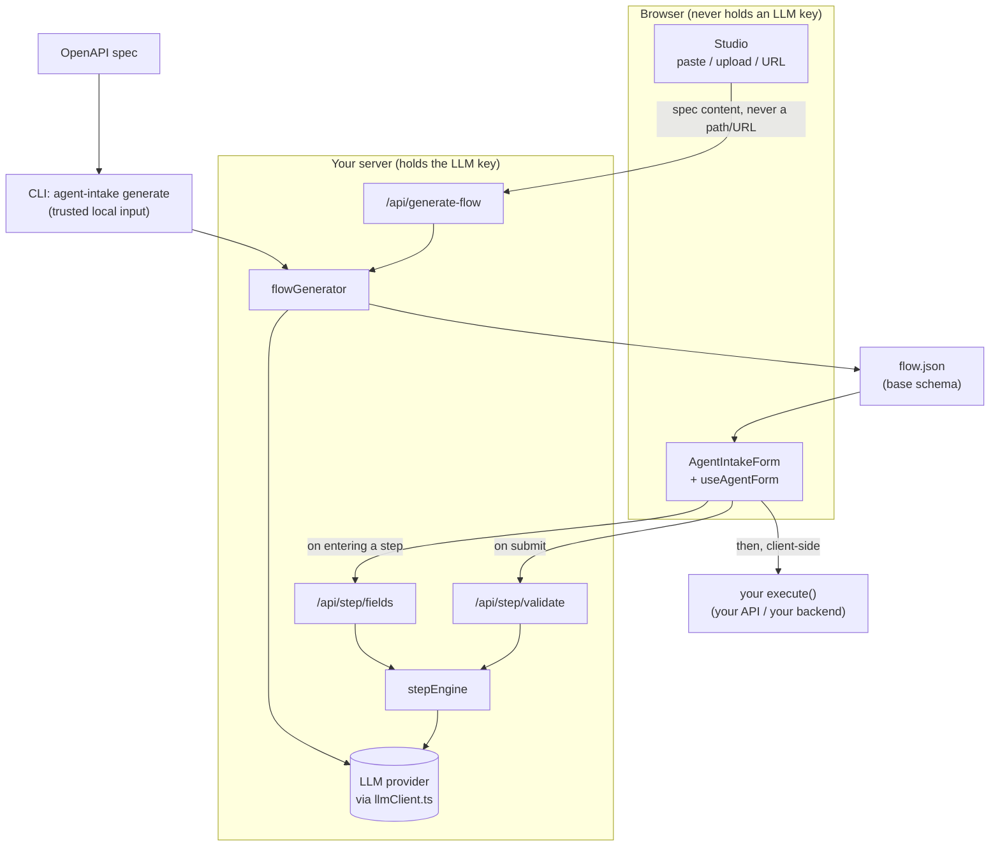
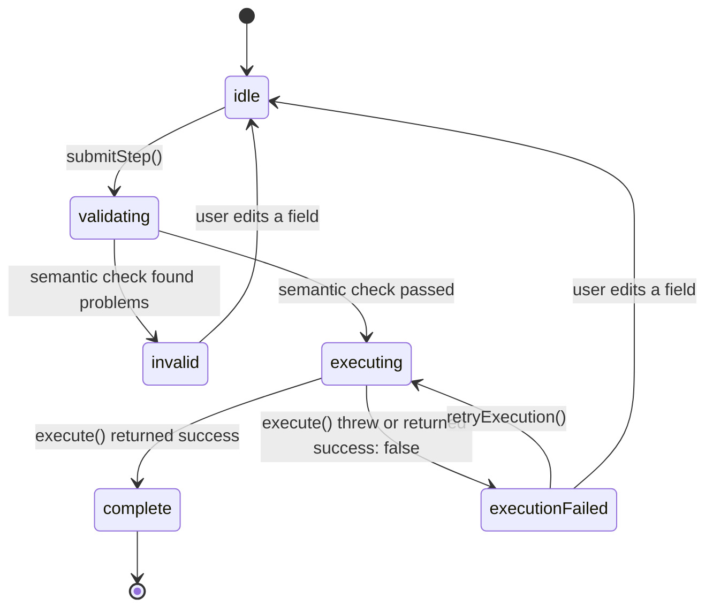

# AgentIntake

**Turn an OpenAPI spec into a single, AI-orchestrated, multi-step form wizard.**

AgentIntake reads your OpenAPI spec to build a base schema (which endpoints, which fields, what's required), then adapts that wizard at runtime: which fields are relevant to show on each step given what the user has already answered, and whether a submitted value is actually plausible. The person filling it out always sees and edits **real form controls, one step per endpoint** — never a chat window.



The CLI and Studio share the same `flowGenerator`; Studio reaches it through `/api/generate-flow`, the CLI calls it directly. Every LLM call happens on the server — **the provider API key never reaches the browser**.

## Why a wizard and not a chat

Multi-endpoint intake (onboarding, KYC-style verification, provisioning) is a form problem: people want to see what's being asked, correct earlier answers, and know how far along they are. A chat transcript hides all of that. So the interaction surface is a wizard, and the AI is an active participant in exactly two bounded ways:

1. **Adaptive field selection, per step.** Before a step renders, the backend asks the model which of that step's base fields are relevant given everything collected so far, in what order, and whether any can be pre-filled with a confident suggestion (shown as AI-suggested and editable).
2. **Semantic validation, per step.** On submit, the model checks values for things regex and range checks can't catch — implausible values, and inconsistencies with earlier steps.

### The "no invented fields" bound

The model can only **show, hide, reorder, annotate, or pre-fill fields that already exist in the base schema**. It can never introduce a field. This is enforced structurally, not by prompt: the LLM's output schema is built per call from the real field names (a Zod enum), so a response naming any other field fails validation and is discarded. The same principle protects generation: `flowGenerator` lets the model supply only a field's `name` and optional label/description overrides — `type`, `required`, `enumValues` and `validation` are always rehydrated from the parsed spec by name, never trusted from the model. (An earlier prompt-only version of this guardrail let a real generation run silently corrupt a field's regex pattern; that is why it's structural now.) Both guardrails have dedicated tests.

## Quickstart

AgentIntake is not published to npm yet; run it from a clone. Requires Node.js 20.19+ or 22.12+ (running the test suite needs 22.12+).

```bash
git clone https://github.com/fdamianenriquez/AgentIntake.git
cd AgentIntake
npm install
npm run build
cp server/.env.example .env   # then add an API key (see "Choosing an LLM provider")
```

`npm run build` compiles the CLI to `dist/`. The commands below use `node dist/cli/index.js`; run `npm link` once if you'd rather type `agent-intake`.

### Path 1 — CLI (developers, scriptable, CI-friendly)

```bash
node dist/cli/index.js generate \
  --spec server/specs/example-payment-onboarding.openapi.yaml \
  --output flow.json
```

`--spec` accepts a local path or URL — the CLI's caller is a trusted local developer, so it fully resolves `$ref`s, including external ones. `--provider` and `--model` override the environment for one run; if you switch providers with `--provider`, `LLM_API_KEY` must hold that provider's key. Generation flags any fields whose purpose it found ambiguous so you can review them.

The output is a `FlowDef` **without** `execute` functions. Review it, then add each endpoint's `execute` by hand — AgentIntake never generates that part (see [Authentication model](#authentication-model)).

### How the spec becomes steps

Each write operation becomes one step, with two refinements:

- **Resource families.** `POST /accounts` together with the operations on `/accounts/{accountId}` is one step, not several. `GET`, `PUT`/`PATCH` and `DELETE` on the item path are recorded on that step as `capabilities` (read, update, undo), along with `resourcePath` and `idParam`. The item path must be exactly the collection path plus one `{parameter}` segment; nested collections such as `POST /accounts/{accountId}/payout-methods` work the same way. A `PUT`/`PATCH` that doesn't belong to such a family (a singleton like `/me/settings`, or an item path with no `POST` on its collection) stays a step of its own, with a warning.
- **Parameters.** Only query parameters and request-body properties become form fields. Path parameters (like `accountId` above) are listed in `pathParams` -- they are ids you fill in your operations from `ctx.results`, not something to ask the user. Header and cookie parameters are never fields; a required header that isn't the auth credential produces a warning so you remember to send it.

The CLI prints these warnings and, after writing `flow.json`, a short list of what each endpoint needs (offered read/update/undo operations, path parameters to fill). Studio shows the same warnings above the preview. If you generated a `flow.json` with an earlier version, regenerate it: item-path updates used to be separate steps, and path and header parameters used to be form fields.

### Path 2 — Studio (no code required)

```bash
node dist/cli/index.js studio          # http://127.0.0.1:4000, opens your browser
node dist/cli/index.js studio --port 4100 --no-open
```

Paste raw spec text, upload a file, or paste a URL. Studio validates that the input looks like OpenAPI before doing anything and shows plain-language errors. Click **Generate** to get a live wizard rendered with the real `<AgentIntakeForm />`, then download `flow.json` or copy the embed snippet.

The preview runs in **Preview mode**: adaptive fields and semantic validation are real LLM calls, but each step's `execute()` is simulated — it logs what it *would* call to the browser console instead of hitting any API. A notice in the UI says so.

Studio itself resolves a pasted URL or uploaded file to spec *content* in your browser first. Fetching a URL from the browser is subject to that host's CORS policy, so some URLs will fail there; pasting the spec text always works.

### Choosing an LLM provider

One `.env` at the project root is the source of truth. It is read from the directory you run the command in.

| Variable | Meaning |
|---|---|
| `LLM_PROVIDER` | `anthropic` (default), `openai`, `google`, or `openrouter` |
| `LLM_MODEL` | Provider-specific model name; optional, each provider has a default |
| `LLM_API_KEY` | Your API key for the provider named in `LLM_PROVIDER` — one variable for all of them, so it must be a key for that provider |
| `AGENTINTAKE_STATIC_MODE` | Any value other than empty, `false` or `0` turns adaptivity off (see below) |
| `PORT` | Port for the runtime server (`npm start`), default `3000` |

Defaults: `anthropic` → `claude-sonnet-4-6`, `openai` → `gpt-4o-mini`, `google` → `gemini-1.5-flash`, `openrouter` → `openrouter/free`. `openrouter` is an extra fourth option (OpenAI-compatible API, reached through the same SDK); `openrouter/free` is OpenRouter's own router across whichever free models are currently available, so it costs nothing to try but can hand consecutive requests to different underlying models.

How each way of running it finds its provider:

- **CLI `generate`** — reads `.env` if present. Variables already set in your shell (for example CI secrets) take precedence over `.env`, and `--provider` / `--model` take precedence over both. It fails fast, before touching the spec, with a specific message if `LLM_API_KEY` is missing or `LLM_PROVIDER` isn't a supported value — never a raw SDK error. Because one variable serves every provider, a key that belongs to a *different* provider can't be detected up front; the provider rejects it on the first call.
- **Studio** — if no valid provider and key are configured, it shows a one-time setup screen in the browser: pick a provider, paste the key. It is written to `.env` in the directory you launched Studio from, so no text-file editing is needed and you aren't asked again next session.
- **Runtime wizard server** (`npm start`) — reads `.env` like the CLI. This is a deployment-time concern of whoever hosts the wizard; the person filling out the form never sees or configures it.

**Honest caveats.** Structured-output reliability varies by provider and by model tier. Anthropic is the default, and every provider goes through the same Vercel AI SDK `generateObject` interface, but no provider has been independently benchmarked here: the end-to-end verification during development was run through OpenRouter's free router. Adaptive selection and semantic validation need genuine reasoning, so a small or cheap model tier may do noticeably worse — and free-tier latency can push a call past its 15-second timeout, in which case the wizard degrades gracefully (below) rather than blocking. Use a capable model for anything beyond experimenting. Live calls against real providers are deliberately not part of the automated tests (they'd need funded keys for every provider on each CI run); provider wiring and the fail-fast errors are.

### Running the demo

The demo is a fixed "Payment Account Onboarding" wizard over three endpoints: `POST /accounts` → `POST /verification` → `POST /payout-methods`.

```bash
npm start                                   # API server on :3000
npx vite --config demo/vite.config.ts       # demo UI on :5173
```

- **Step 1** asks for an account type, `individual` or `business`. In **step 2**, every verification field is optional in the OpenAPI schema (OpenAPI can't express "required only if an earlier answer was X"), and the step engine narrows the set at runtime: choosing `individual` shows only the three individual fields, `business` shows the five business ones. A whole field set swaps out, not one toggle.
- **Step 3** collects an account holder name. Its description invites a cross-step check, so a name that doesn't plausibly match the one collected earlier is rejected with an explanation no regex could produce.

Each step's `execute()` in the demo just logs to the console and succeeds. Field names are deliberately generic and fictional; the demo illustrates the mechanism and is **not** guidance on the KYC/KYB requirements of any jurisdiction.

## Authentication model

AgentIntake **surfaces** what authentication each endpoint declares (`EndpointDef.auth`, extracted from the spec's `securitySchemes`). It does **not** manage, store or refresh credentials, and it isn't an auth library. Two patterns:

1. **Backend-proxied `execute()` (recommended).** `execute()` calls your backend, and your backend holds the credential and forwards the request. The secret stays server-side, and it sidesteps CORS — most third-party and internal APIs won't allow your wizard's origin.
2. **Direct from the browser, user-scoped token only.** For APIs explicitly designed for it. Pass `getAuthHeaders: () => Record<string, string>` to the hook or component; it's handed to `execute()` in its `context` argument.

No OAuth login flow, token refresh or credential storage is provided.

## React API

The package lives in `packages/react-agent-intake` (published name: `react-agent-intake`).

```tsx
import { AgentIntakeForm } from 'react-agent-intake';

<AgentIntakeForm flow={flow} apiUrl="http://localhost:3000" getAuthHeaders={optional} />
```

`AgentIntakeForm` is a thin, replaceable consumer of the hook. It maps `FieldDef.type` (`string`, `number`, `boolean`, `date`, `enum`) to generic controls with no per-field JSX, shows a stepper, and marks completed steps.

```ts
function useAgentForm(
  flow: FlowDef,
  options: {
    apiUrl: string;
    getAuthHeaders?: () => Record<string, string> | Promise<Record<string, string>>;
  }
): {
  currentStepIndex: number;
  totalSteps: number;
  currentStepFields: FieldDef[];
  suggestedValues: Record<string, unknown>;
  values: Record<string, unknown>;
  errors: Record<string, string>;      // set only when currentStepStatus === 'invalid'
  currentStepStatus: StepStatus;
  executionError: string | null;       // set only when currentStepStatus === 'executionFailed'
  loading: boolean;                    // fetching this step's adapted fields
  updateField: (fieldName: string, value: unknown) => void;
  submitStep: () => Promise<void>;
  retryExecution: () => Promise<void>;
  completedEndpoints: string[];        // endpoint ids that reached 'complete'
  isComplete: boolean;
  stepRecords: Record<string, StepRecord>; // per step: last submitted values, result, status
  error: Error | null;                 // fatal, e.g. a flow with no endpoints
};
```

The hook manages its own `sessionId`, fetches the current step's adapted fields whenever the step changes, and aborts any in-flight request on unmount.

Each endpoint gets either `execute` or `operations` (exactly one):

```ts
interface EndpointDef {
  id: string;
  title: string;
  description?: string;
  fields: FieldDef[];
  auth?: AuthRequirement;
  execute?: (data: Record<string, unknown>, context: ExecContext) => Promise<OperationResult>;
  operations?: { create: /* same signature as execute */ };
}

interface ExecContext {
  getAuthHeaders?: () => Record<string, string> | Promise<Record<string, string>>;
  results: Record<string, OperationResult>; // results of completed steps, by endpoint id
  idempotencyKey: string;                   // same across retries, new after the user edits
}

interface OperationResult {
  success: boolean;
  message?: string;
  resourceId?: string;                      // e.g. the id your API created
  output?: Record<string, unknown>;         // anything a later step needs
  failure?: { kind: 'network' | 'timeout' | 'http' | 'other'; status?: number; message?: string };
}
```

`execute` is the original form and is exactly `operations.create`. Later steps often need what an earlier one created; it arrives as `context.results`:

```ts
import { failureFromResponse } from 'react-agent-intake';

operations: {
  create: async (data, { results, idempotencyKey }) => {
    const accountId = results.createAccount.resourceId;
    const res = await fetch(`/api/accounts/${accountId}/payout-methods`, {
      method: 'POST',
      headers: { 'Content-Type': 'application/json', 'Idempotency-Key': idempotencyKey },
      body: JSON.stringify(data),
    });
    if (!res.ok) return { success: false, failure: await failureFromResponse(res) };
    const created = await res.json();
    return { success: true, resourceId: created.id };
  },
}
```

AgentIntake never calls your API and never inspects its responses itself; mapping a response into an `OperationResult` is your job. `failureFromResponse` does that for errors (status plus the first 500 characters of the body). A thrown error, or a failed result without a `failure`, is recorded as `kind: 'other'`. Return `resourceId` from `create` whenever your API gives you one: the planned back-navigation and undo (see [Roadmap](#roadmap)) depend on it. Pass `idempotencyKey` along if your API supports idempotency keys, so a retry after a timeout can't create a duplicate.

### The `StepStatus` lifecycle

`submitStep()` runs a fixed sequence, and `currentStepStatus` is the single source of truth for where the step is in it.



A validation failure and an execution failure are deliberately different states. **`invalid`** means "fix your answer": the server's semantic check rejected it, inline errors are shown, and `execute()` was never called. **`executionFailed`** means "your answer was fine, something else went wrong": the data already passed validation, the step stays open, and `retryExecution()` calls `execute()` again with the same data without re-running the semantic check. Only `complete` — `execute()` succeeded — draws the checkmark and advances the wizard.

`execute()` always runs **client-side**, in the same process as the hook. The server only ever returns a verdict.

### Server routes

The three routes are mounted by `createApp()` in `server/src/app.ts`:

| Route | Body | Returns |
|---|---|---|
| `POST /api/generate-flow` | `{ specContent }` — raw JSON or YAML text | `{ flow, ambiguousFields, warnings }` |
| `POST /api/step/fields` | `{ sessionId, endpoint }` | `{ fields, suggestedValues, degraded }` |
| `POST /api/step/validate` | `{ sessionId, endpoint, data }` | `{ valid, errors, degraded }` |

## What is sent to the LLM provider

AgentIntake calls the provider you configure, from your server, with:

- **Generation (CLI or Studio):** the write operations parsed from your spec — their paths, field names, types, descriptions and validation rules.
- **Each wizard step:** that step's field definitions, **the answers the user has given so far in this session**, and, on submit, the answers for the step being validated.

So end users' form answers leave your infrastructure and reach the LLM provider under that provider's data policy. If your intake collects personal or regulated data, check that policy before deploying, or turn the per-step calls off with `AGENTINTAKE_STATIC_MODE` (below). The API key itself never reaches the browser.

## Resilience: graceful degradation

A transient failure in an enhancement call never takes the wizard down. If `/api/step/fields` fails or times out, that step shows its **full, unfiltered base field list**. If the semantic check can't complete, the step falls back to accepting client-side validation alone. When the server itself degrades it says so with `degraded: true`; if the request to the server fails outright, the hook falls back on its own. Both paths are covered by tests.

For deployments that would rather trade adaptivity for cost, set `AGENTINTAKE_STATIC_MODE=1`: both per-step LLM calls are skipped entirely, and every step uses its full base field list with client-side validation — the same code path as the degradation fallback. Every wizard step otherwise costs at least one LLM call, two when validation also runs.

Flow generation has no fallback to degrade to, so it is bounded differently: the request is cancelled after 120 seconds and the CLI or Studio reports that the model didn't respond, rather than waiting indefinitely.

## Known operational boundaries

Stated plainly, because a multi-endpoint, AI-in-the-loop wizard has failure modes a static form doesn't.

- **No authentication on AgentIntake's own routes.** This is a self-hosted library, not a multi-tenant service. Put the routes behind your own auth middleware, gateway, reverse proxy or private network if you expose them beyond localhost. A `sessionId` is a client-generated opaque string, closer to a shopping-cart id than a user id; it gives no confidentiality beyond "don't leak your own."
- **No built-in rate limiting.** Nothing limits `/api/generate-flow`, `/api/step/fields` or `/api/step/validate`, and each call spends LLM tokens. Fine for local use; **do not expose a public or shared instance of the demo, Studio or server without adding rate limiting first.**
- **No cross-endpoint rollback.** If step 2's `execute()` fails after step 1's succeeded, step 1's effect is not undone. The wizard surfaces the error and lets the user retry that step only.
- **No backward navigation.** Once a step has completed, it can't be revisited, which avoids re-submission and duplicate-record ambiguity.
- **No idempotency handling.** If a connection drops mid-submit and the user retries, the target endpoint may be called twice. If duplicate calls aren't safe, implement idempotency (for example an idempotency-key header) inside your `execute()`.
- **Static enums only.** `enumValues` come from the spec's own `enum` declarations; options fetched from another endpoint aren't supported.
- **Sized for a handful of related write operations.** Above 15 write operations, generation and Studio warn that quality may degrade. Chunked generation isn't built.
- **In-memory sessions.** Session state is a process-local map; there's no persistence across restarts. A session expires after 2 hours without activity, and at most 10,000 are kept (least recently used are dropped first), so a long-running server's memory stays bounded.
- **Spec size.** `/api/generate-flow` accepts request bodies up to 10 MB; the per-step routes keep a 100 KB limit, since they only carry one endpoint and its answers.
- **Small-model quality.** See the provider caveats above.

One thing that is a fix, not a boundary, but worth being visible about: **`/api/generate-flow` never fetches a caller-supplied path or URL itself.** It accepts only spec *content* and parses it with external `$ref` resolution disabled, closing an SSRF / local-file-disclosure vector. Only the CLI resolves paths and URLs, where the caller is the trusted developer running it. Studio's own provider-setup routes (which write an API key to `.env`) are mounted only by the local `studio` command and are never part of `createApp()`. Studio also listens on 127.0.0.1 only, and rejects requests whose `Host` isn't a loopback name or whose `Origin` isn't Studio itself, so neither other machines nor other websites open in your browser can reach it.

## Roadmap

Planned for **v1.5 — Smart Recovery** (fully designed, not abandoned): the two v1 boundaries above, rollback and backward navigation, become agent-assisted. Where the spec exposes a CRUD family for a resource, a failed later step would be classified as transient or fundamental and earlier resources rolled back through their own `delete`; navigating back would check existence with a `read` and use `update` instead of `create`; and editing an earlier answer that plausibly invalidates a later step would surface a warning.

Smaller stretch goals, roughly in priority order: dynamic enum options, chunked generation for large specs, rate-limiting middleware, free-text bulk fill, hosted Studio with shareable links, multi-spec cross-service flows, an explicit LangGraph state graph for the step engine, session persistence, and a visual `FlowDef` editor.

## Development

```bash
npm test               # Vitest suite
npm run test:watch
npx vitest run --coverage
npm run build          # tsc -> dist/
```

## License

MIT — see [LICENSE](LICENSE).
